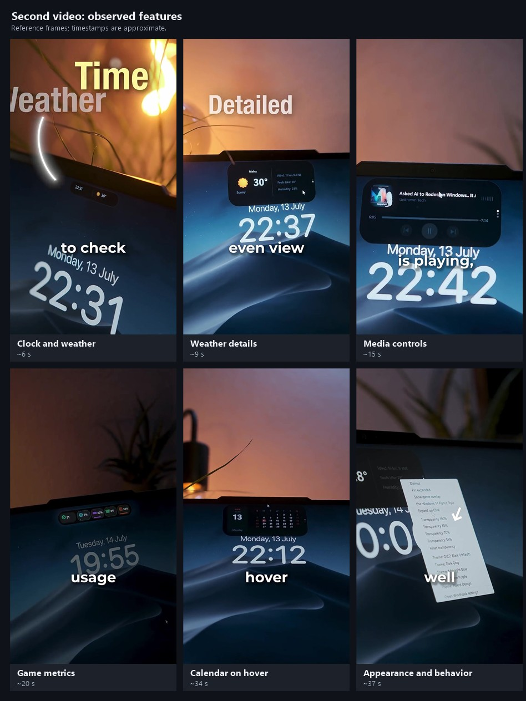

# PILL next-version plan

Updated 31 October 2026 after reviewing both supplied videos and the current repository. Release numbers below are proposed milestones.

## Product direction

Evolve PILL into a useful, customizable Windows island, then add an optional local assistant through the same interface. The second video broadens the original draft: clock/calendar, weather, media visualization, game metrics, progress, and precise window behavior all need explicit implementation work.

Keep the existing Tauri, React, TypeScript and Rust applications. Build these interactions into PILL and PILL Control. The Windhawk installation steps shown in the reference are demonstration content, not instructions to install software or change PILL's architecture.

## Evidence from the two videos

### First video: assistant interaction

Video-60774.mp4 is approximately 18 seconds long. Sampled frames show a small two-dot island expanding into a narrow transcript/status surface, then YouTube results and a video opening. Its overlay text describes an offline assistant; this does not verify its implementation or offline operation. Online search and playback still require networking. Audio and the exact activation/command sequence were not verified in that review.

### Second video: island features

Did-you-know-SnapYT.App (1).mp4 is 40.40 seconds long. FFmpeg successfully decoded it after the initial Windows extraction method produced black frames. The supplied file has a video stream and no audio stream. This review uses visible screens and captions sampled across the entire clip, with denser inspection around settings and feature changes. Times below are approximate.

The recording identifies the showcased software as Windhawk's Dynamic Island for Windows; version 1.1.1 is visible during the installation portion. This describes the recording, not its current published version.

| Approximate time | Visible evidence | Requirement for PILL |
| --- | --- | --- |
| 00:00–00:02, 00:21–00:22, 00:34 | Month grid, highlighted date and large day/date; calendar appears after approaching the hidden island | Local clock/date, month calendar and hover reveal |
| 00:06–00:08 | Compact time, weather icon and temperature | Useful idle state with configurable clock and weather |
| 00:09–00:11 | City, condition, temperature, wind, feels-like and humidity in an expanded card | Detailed weather module |
| 00:12–00:17 | Compact artwork/activity marks; expanded artwork, title/artist, progress/time, previous/pause/next and labelled visualizer | Refined media layouts and real audio visualization; seeking itself is not demonstrated |
| 00:18–00:19 | Progress module setting describes a ring for downloads | Track progress-ring support; actual download detection is not demonstrated |
| 00:18–00:21 | Game mode settings mention FPS/CPU/RAM; compact metric chips appear; labels can be enabled | Dedicated performance strip with validated data sources |
| 00:18–00:19 | Weather city and Fahrenheit settings | Explicit city selection and unit preferences |
| 00:32–00:34 | Size scale; hide instantly/never/5/10/30/60 seconds; hidden island then hover reveal | Independent scale, idle-hide timer and reliable reveal region |
| 00:35–00:38 | Right-click menu: dismiss, pin expanded, game overlay, Windows 11 flyout shape, expand on click, opacity/reset, themes, settings | Quick context menu sharing persistent settings with Control |

The large wallpaper clock, dock/taskbar styling and separate desktop widgets are visible around the island. Their presence does not establish that they belong to its module. Keep those as separate scope decisions. Clipboard history, notifications and a file shelf are also not established by this clip.

## Current implementation to preserve and extend

Source inspection establishes this baseline; it is not a substitute for Windows runtime testing.

| Existing area | Implementation and gap |
| --- | --- |
| Media | Metadata, artwork, position/duration and previous/play-pause/next already exist in archipelago/src-tauri/src/media.rs and frontend state components |
| Telemetry | CPU/RAM source exists in archipelago/src-tauri/src/telemetry.rs; it currently polls every two seconds. GPU/disk/game FPS need new providers |
| Focus | Native start/pause/reset for a fixed 25-minute timer. Arbitrary durations need a native contract change |
| Presentation | Idle/compact/expanded/split, hover/click expansion, collapse, fullscreen hiding and click-through exist |
| Settings | Theme/startup/tray values exist, but inspection did not establish working overlay theme switching or native startup/tray behavior |
| Missing modules | Clock/calendar/weather, real audio visualization, progress adapters and the assistant pipeline need implementation |

Repository paths above are under PILL/. Shared settings are in PILL/shared/settings/PillSettings.ts; Control is in PILL/pill-control.

## Target design and behavior

### Content and visual design

The compact idle island shows time and optional weather. Active media adds artwork and a restrained activity indicator. Focus and progress can occupy a secondary slot. Expansion shows one readable module at a time: Calendar, Weather, Media, Focus or Performance.

Provide an explicit view selector, keyboard navigation and optional wheel navigation. Pagination dots may show position but must not be the only navigation mechanism. Wheel navigation is a proposed convenience, not a gesture verified from the recording.

Keep the top-center anchor stable through resizing. Use consistent spacing, clear typography and a dark rounded surface. Offer pill and Windows-style rounded-panel shapes. Start with black, graphite, blue, purple and a Fluent-inspired theme, backed by shared color/spacing/motion tokens. Genuine acrylic/blur needs separate native verification; a theme name alone does not establish native material support.

Apply opacity to the background while preserving readable controls and text. Expose clearly named 100/85/70/55 percent opacity presets and reset. Scale the whole island within readable minimums and the available monitor work area. Account for Windows DPI, shadows and animation bounds.

### Interaction rules

- Hover/click expansion is configurable. Add hover intent; clicking controls inside a card must not trigger a second island action.
- Collapse returns to compact after pointer leave. Idle hide removes an inactive compact island after a separate timer. Default to never hide for discoverability.
- Hidden reveal uses a narrowly bounded native cursor-detection region or another measured approach that does not swallow underlying application clicks. An invisible click-through window cannot simply be assumed to receive hover events. Provide shortcut and tray reveal alternatives.
- Pin expanded retains the selected module until unpinned. Opening the context menu suspends collapse. Escape and outside-click dismissal behave predictably.
- Dismiss hides the surface until explicit reveal; Quit is a separate command.
- Ordinary fullscreen hiding remains the default. An explicitly enabled game profile may retain the performance strip in supported windowed/borderless games. Exclusive-fullscreen and protected-game compatibility require testing.
- User-selected/pinned content and assistant input own the surface. Background weather/telemetry updates cannot replace them. Completion badges do not discard the current view.
- Restore the previous module after assistant completion. Reduced motion, keyboard focus, screen-reader labels and adequate contrast apply throughout.

## Feature implementation and completion criteria

| Feature | Build approach | Completion criterion |
| --- | --- | --- |
| Clock/calendar | Local module using system locale/timezone, 12/24-hour setting, month navigation and today highlight | Correct across midnight, month boundaries, sleep/resume and timezone changes; works offline |
| Weather | Rust provider boundary, selected city, units, cache timestamp and refresh/backoff. Choose provider after checking attribution, terms and limits | Compact/detail agree; loading/stale/unavailable/offline states are explicit; disabled means no requests |
| Media | Reuse Windows source; improve layouts, title overflow, cover fallback and supported-control states | Works with supported players and missing metadata. Add seeking only with a tested native seek command |
| Visualizer | Prototype WASAPI output loopback; send bounded level/band summaries to UI | Responds to real output, stops on silence/pause, handles device changes, stores no audio, and has a calm unsupported fallback |
| Performance | Reuse CPU/RAM; capability-based GPU/disk providers; separately evaluate target-application FPS | Every metric has a named meaning/source/unit; unavailable is N/A; game FPS never comes from PILL's animation loop |
| Progress ring | Shared event contract with task/source ID, completed/total or indeterminate, state and timestamp | Completion, failure, cancellation and concurrent tasks render correctly; no fabricated percentages |
| Download adapter | Feasibility spike for one explicit source, potentially an opt-in browser/native bridge | Real start/progress/end and reconnect work; supported apps/browsers are documented; no universal download-detection claim |
| Context menu/appearance | Shared settings update API for island and Control; persistent pin/shape/theme/opacity/expansion preferences | Live changes persist, both interfaces agree, reset works |
| Placement/lifecycle | Shared size contract, monitor/offset preference, per-module start/stop and completed tray/startup behavior | No clipping/stranding after monitor changes; disabling expensive modules stops work; settings have observable effects |

[Microsoft's WASAPI documentation](https://learn.microsoft.com/windows/win32/coreaudio/loopback-recording) establishes that loopback captures a rendering endpoint's output, normally the system mix. Label that scope; do not imply it measures only the displayed media application. Protected output may be unavailable.

[PresentMon's primary repository](https://github.com/GameTechDev/PresentMon) provides a candidate for investigating ETW-based application FPS. The spike must check overhead, privileges, licensing and distribution. These technologies have not yet been integrated or benchmarked in PILL.

## Architecture work before adding modules

1. Centralize transition ownership across archipelago/src/hooks/useIslandState.ts, useWidgetLayoutSync.ts and useEvasion.ts. Hook instances currently own separate collapse timers and native-sync refs; pin/hide/game/assistant behavior needs one shared coordinator.
2. Separate visibility (shown/auto-hidden/dismissed/fullscreen-hidden), presentation (compact/expanded/split), selected module and interaction ownership. Game mode is a presentation policy; assistant listening is session state.
3. Introduce an internal module registry declaring views, availability, priority, provider and lifecycle. Incrementally replace the specialized focus/media branches in ExpandedState.tsx. A third-party plugin SDK is outside this milestone.
4. Share validated frontend/native event and size contracts. Resolve the frontend idle dimensions of 44x14 versus startup/config dimensions of 110x32. Update Rust state parsing and native resizing together.
5. Migrate settings version 1 without losing choices. Extend the shared TypeScript schema and both Rust implementations with clock/weather, appearance, hide/reveal, pin, performance and progress settings. Use atomic writes and a conflict policy so Control and the island cannot overwrite unrelated preferences with stale snapshots.
6. Keep data collection in Rust and rendering in React. Disabled providers stop. Weather refreshes infrequently; clocks update only as needed; visualization emits bounded summaries while active. Measure CPU, memory, wakeups, renders and native resizing before fixing release budgets.

## Proposed delivery sequence

### PILL 0.2 — Everyday Island

Deliver the foundation and the core reference features:

1. Establish current test/runtime baseline; fix shared transition ownership and sizing.
2. Add module navigation, clock and calendar.
3. Add persistent themes, opacity, shape, scale and context menu.
4. Implement independent collapse/hide, hover reveal, pin, keyboard access and fullscreen precedence.
5. Add weather and refined media cards while retaining focus/telemetry.
6. Complete tray/startup, settings migration and Windows DPI/multi-monitor validation.

Gate: the island is useful offline with weather disabled, and every exposed setting has working behavior. Rough planning estimate: 4–6 engineering weeks for one experienced developer after baseline; revise against actual capacity and integration findings.

### PILL 0.3 — Live Signals

Deliver audio visualization, the performance strip, validated game FPS, progress ring and the first supported download adapter. Run audio/FPS/download spikes early during 0.2. CPU/RAM can ship before optional metrics; missing providers show unavailable.

Gate: measurements are real, unsupported sources are explicit, game-profile compatibility/overhead is documented, and disabled modules suspend collection. Download progress remains a tracked milestone even if its connector needs a separate release.

Rough estimate: 3–6 additional engineering weeks, with FPS and download integration the largest unknowns. A failed spike requires an explicit scope decision.

### PILL 0.4 — Optional Assistant

Preserve the first video's interaction: shortcut/click → typed input or opt-in push-to-talk → visible interpretation → bounded action → readable result → restore the previous island view.

Build typed commands first: media/focus controls, a user-configured app launcher and explicit browser searches. Extend the timer if arbitrary durations are supported. Add local speech recognition after measuring accuracy, latency, model storage and hardware requirements. A local language model is optional for this command set.

Control gets assistant activation, microphone/device, model setup, action permissions and history preferences. Keep microphone state, cancel and stop visible. Retain no raw audio/transcripts by default. Validate action proposals against a fixed schema; model output cannot become arbitrary shell execution.

Local actions must work with networking disabled after setup; online actions are labelled. Automatic result selection/playback, wake words and broader screen automation require separate feasibility work. Rough estimate: 4–8 additional engineering weeks for typed plus push-to-talk, revisited after the voice spike. These are planning ranges, not a calendar commitment.

## First implementation tickets

| Order | Ticket | Main locations | Acceptance |
| --- | --- | --- | --- |
| 1 | Shared transition coordinator and window contract | archipelago/src/hooks, src/store/islandStore.ts, src-tauri/src/lib.rs | Rapid hover/leave/fullscreen cannot apply stale resize/click-through state |
| 2 | Module registry and selected-view navigation | archipelago/src/components/states, src/lib/widgetOrchestrator.ts | Explicit module selection survives background updates |
| 3 | Clock/calendar vertical slice | New module components and clock source | Local time and calendar work end to end, including rollover |
| 4 | Unified settings updates and migration | shared/settings, both Rust settings modules, pill-control/src | Version 1 choices survive; concurrent changes preserve unrelated values |
| 5 | Appearance and behavior | Island components, tokens and native shell | Pin, scale, theme, opacity and hide/reveal work together and persist |
| 6 | Weather and media polish | New weather provider; existing media adapter/components | Live, stale, offline, missing-metadata and disabled-control states work |
| 7 | Audio/FPS/download feasibility | Isolated native provider prototypes | Measured results and source-support matrix guide 0.3 implementation |

## Verification and release criteria

- Run existing frontend tests/build, Rust tests, and Control lint/build. Add meaningful tests for transition precedence, date rollover, stale weather, provider capabilities, settings migration/conflicts and assistant action validation.
- Exercise reference flows on Windows: clock/weather → calendar → media → performance; hide/reveal; right-click while expanded; pin/leave; theme/opacity; active focus plus media; game mode entering/leaving fullscreen.
- Verify keyboard-only operation, reduced motion, 100/125/150/200 percent DPI, mixed monitors, unplug/reconnect, small work areas, sleep/resume, device/player changes, offline behavior and clean install/upgrade.
- Measure latency, CPU/memory and capture overhead on a low-end and a typical supported PC. Establish thresholds from PILL's baseline; do not adopt unverified zero-CPU or frame-rate claims from the reference.
- Check every video-evidence row against a reproducible end-to-end behavior. A visible setting alone does not establish delivery.

This update covers planning and reference analysis. Application code has not been changed or runtime-tested as part of this review.
